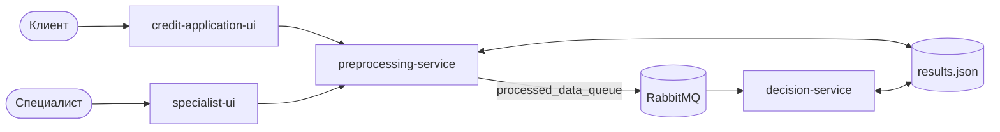

# Интеграция для предварительной оценки кредитных заявок

Курсовой проект по архитектуре интеграции и его разбор с позиции системного аналитика. Работающий прототип из 5 контейнеров принимает заявку на кредит, передаёт её через RabbitMQ в систему принятия решений, автоматически одобряет или отклоняет типовые заявки, а пограничные отправляет кредитному специалисту.

Поверх прототипа: требования восстановлены и проверены 11 сценариями на запущенной системе. 5 сценариев прошли, 6 выявили расхождения. Для каждого расхождения есть причина в коде, оценка риска и требование TO-BE.

Стек: Python, FastAPI, RabbitMQ, Docker Compose. Документация: требования с критериями приёмки, Mermaid (процесс, состояния, последовательности), OpenAPI 3.1, AsyncAPI 3.0, JSON Schema, таблица решений.

## Главное

| Что нашёл | Как проверено | Что предлагаю |
|---|---|---|
| **Кредит в 5 годовых доходов одобряется автоматически**: сумма и срок не участвуют в решении | одна и та же заявка на 150 тыс. и на 5 млн ₽ → `APPROVED`, score 76,43 в обоих случаях | считать PTI с платежом по новому кредиту, отсекать при PTI > 0,60 |
| **Под нагрузкой теряются заявки**: оба сервиса переписывают один JSON-файл | из 40 одновременных заявок 21 получила 500, из 19 принятых 8 остались без решения | один владелец статуса с PostgreSQL, решения — событиями, условное обновление статуса |
| Правила в коде расходятся с документацией | score 36 при нагрузке 50% → ручная проверка вместо отказа | таблица решений с политикой FIRST и кодами причин |
| При недоступном брокере клиент ждёт 20 с, а заявка навсегда зависает в `PROCESSING` | остановлен RabbitMQ → 503 через 20 с | шаблон outbox |
| Ошибочное сообщение удаляется без следа | сообщение без признаков пропало из очереди за 3 с | очередь ошибок (DLQ), статус `FAILED`, оповещение |
| Интерфейс специалиста открыт без входа, у решения нет автора и кода причины | по коду | SSO и роль, обязательный код причины, журнал решений |

Что работает как задумано: валидация, ручная проверка, а также доставка при остановленной системе решений — сообщение ждёт в очереди и обрабатывается после запуска.

## Документация

| Раздел | Содержание |
|---|---|
| [1. Контекст](docs/01-context.md) | задача, участники, схема контекста, границы, глоссарий |
| [2. Требования](docs/02-requirements.md) | 5 историй, 11 функциональных и 7 нефункциональных требований со статусом проверки, критерии приёмки в Gherkin |
| [3. Процесс и статусы](docs/03-process.md) | процесс рассмотрения AS-IS с тупиковыми ветками, жизненный цикл заявки |
| [4. Интеграция](docs/04-integration.md) | параметры канала, диаграммы последовательности для основного сценария и сбоев, outbox |
| [5. Правила решения](docs/05-decision-rules.md) | признаки, score, таблицы решений AS-IS и TO-BE, вопросы к риск-менеджменту |
| [6. Разбор расхождений](docs/06-gap-analysis.md) | 9 расхождений: факт, причина в коде, риск, требование |
| [OpenAPI](docs/api/openapi.yaml) · [AsyncAPI](docs/api/asyncapi.yaml) · [JSON Schema](schemas/processed_message_schema.json) | контракты AS-IS с пометками TO-BE |



## Запуск

```bash
docker compose up --build -d
python3 scenarios/run.py
```

| Адрес | Что там |
|---|---|
| http://localhost:8080 | форма заявки для клиента |
| http://localhost:8081 | АРМ кредитного специалиста |
| http://localhost:8000/docs | API сервиса предобработки (Swagger) |
| http://localhost:15672 | RabbitMQ Management, `guest` / `guest` |

Сценарии используют только стандартную библиотеку Python. Сценарии 8 и 10 останавливают и снова запускают контейнеры. Результат последнего прогона — [scenarios/result.txt](scenarios/result.txt).

Примеры запросов — в [examples/](examples):

```bash
curl -X POST localhost:8000/applications -H 'Content-Type: application/json' -d @examples/request.json
curl localhost:8000/status/REQ-001
```

## Структура

```
credit-application-ui/   форма заявки (FastAPI, HTML)
preprocessing-service/   приём, валидация, признаки, публикация, статус, ручная проверка
decision-service/        потребитель очереди: score и решение
specialist-ui/           АРМ кредитного специалиста
schemas/                 JSON Schema сообщения
scenarios/               проверочные сценарии и результат прогона
docs/                    документация системного анализа
```

Код прототипа оставлен в виде, в котором он сдавался как курсовая: разбор описывает систему такой, какая она есть. Единственное изменение — из `docker-compose.yml` убраны фиксированные имена контейнеров, чтобы проект запускался рядом с другими.

---
Автор — Никита Джахнаев, Telegram [@snnvw](https://t.me/snnvw). Курсовая работа РТУ МИРЭА, 2026.
