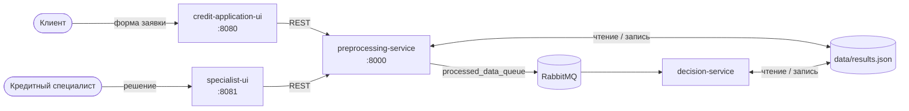

# 1. Контекст и границы

## Задача

Банк принимает онлайн-заявки на потребительский кредит. Нужна предварительная автоматическая оценка: простые заявки одобряются или отклоняются сразу, пограничные уходят кредитному специалисту. Клиент видит статус заявки по её номеру.

Интеграционный кейс — асинхронная передача подготовленных данных заявки из сервиса предобработки в систему принятия решений через брокер сообщений. Шаблон интеграции — **очередь точка-точка с гарантированной доставкой**: заявка не теряется, если система принятия решений временно недоступна.

## Участники

| Участник | Что делает |
|---|---|
| Клиент | Заполняет заявку, смотрит статус |
| Кредитный специалист | Принимает решение по заявкам на ручной проверке |
| Сервис предобработки | Проверяет заявку, считает признаки, публикует сообщение, отдаёт статус |
| Система принятия решений | Читает сообщения, считает score, выносит решение |

## Контекст системы

Пять контейнеров: два интерфейса, два сервиса и брокер. Результаты хранятся в одном JSON-файле, который смонтирован в оба сервиса. Это главный архитектурный риск, см. [разбор расхождений](06-gap-analysis.md).

## Границы

- **Входит:** приём заявки, расчёт признаков, передача через очередь, автоматическое решение, ручная проверка, статус.
- **Не входит:** аутентификация клиента, запросы в бюро кредитных историй, выдача кредита, уведомления.

## Глоссарий

| Термин | Значение |
|---|---|
| Долговая нагрузка (`debt_ratio`) | Ежемесячные платежи по текущим кредитам / ежемесячный доход. Платёж по новому кредиту в прототипе **не учитывается** |
| PTI | Payment-to-income: все платежи, включая новый кредит, / доход. Предлагается вместо `debt_ratio` |
| score | Балл 0–100, взвешенная сумма четырёх признаков |
| MANUAL_REVIEW | Статус заявки, которая ждёт решения специалиста |
| DLQ | Очередь недоставленных сообщений: сюда попадают сообщения, которые нельзя обработать |
| Outbox | Шаблон: сообщение сохраняется в БД в одной транзакции с данными и публикуется отдельным процессом |
