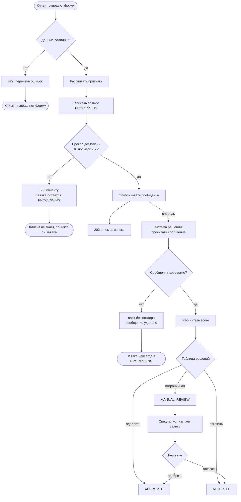
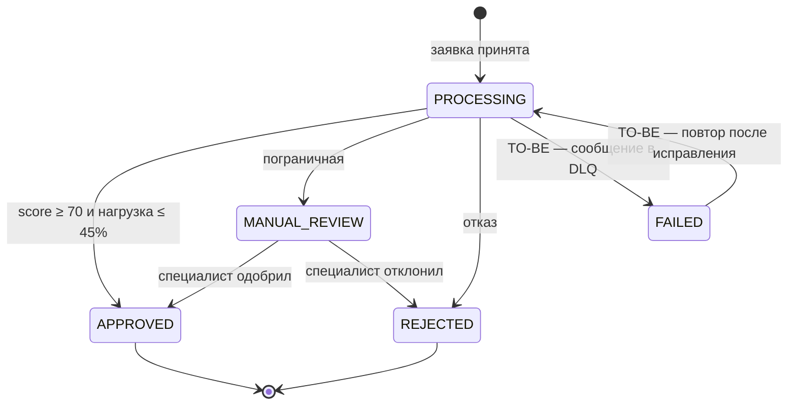

# 3. Процесс и статусы заявки

## Процесс рассмотрения (AS-IS)

Ветки E1 и I1 — тупики: заявка застревает в `PROCESSING`, а клиент и банк об этом не знают. Они разобраны в [расхождениях](06-gap-analysis.md) G-5 и G-6.

## Жизненный цикл заявки

| Статус | Кто ставит | Финальный | Видит клиент |
|---|---|---|---|
| `PROCESSING` | сервис предобработки | нет | «Заявка рассматривается» |
| `MANUAL_REVIEW` | система решений | нет | «Заявка рассматривается» — клиенту не нужно знать о ручной проверке |
| `APPROVED` | система решений или специалист | да | «Одобрено» |
| `REJECTED` | система решений или специалист | да | «Отказано» |
| `FAILED` | TO-BE: система решений | нет | «Заявка рассматривается»; оповещение дежурному |

Сейчас статус меняют три участника (предобработка, система решений, специалист через предобработку), и все пишут в один файл. В TO-BE у статуса один владелец — сервис заявок, остальные присылают ему события.
