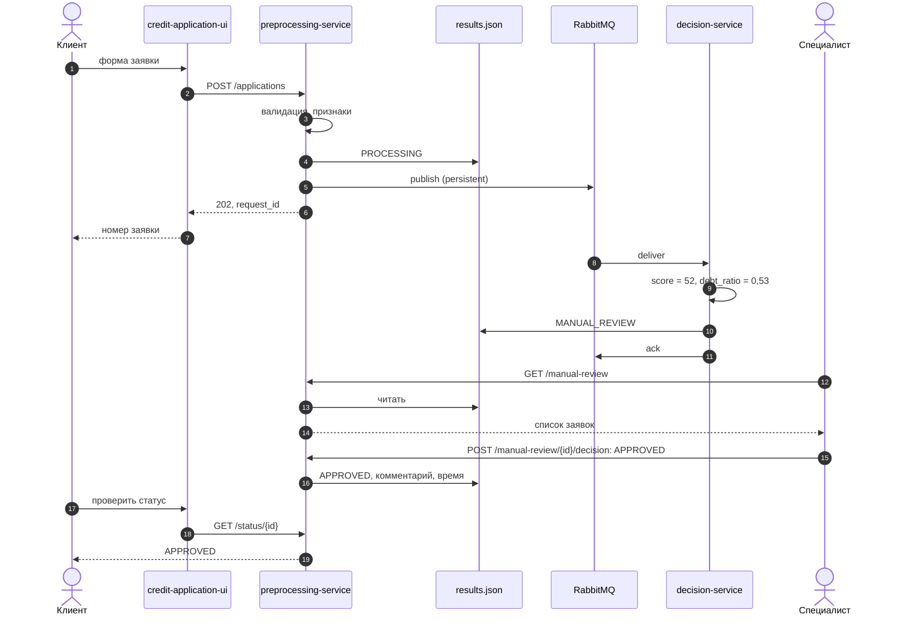
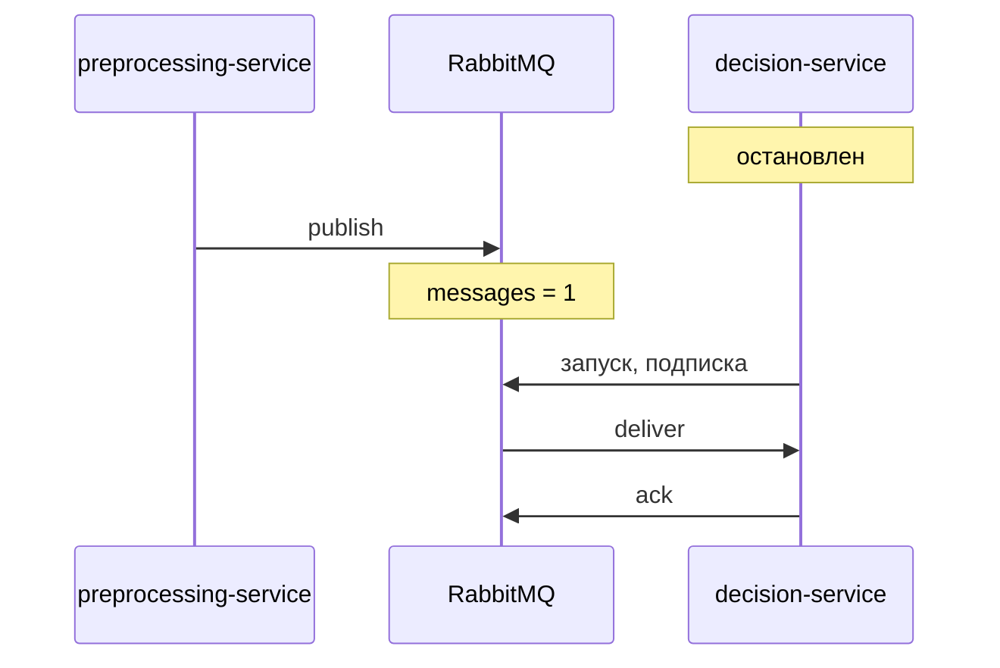
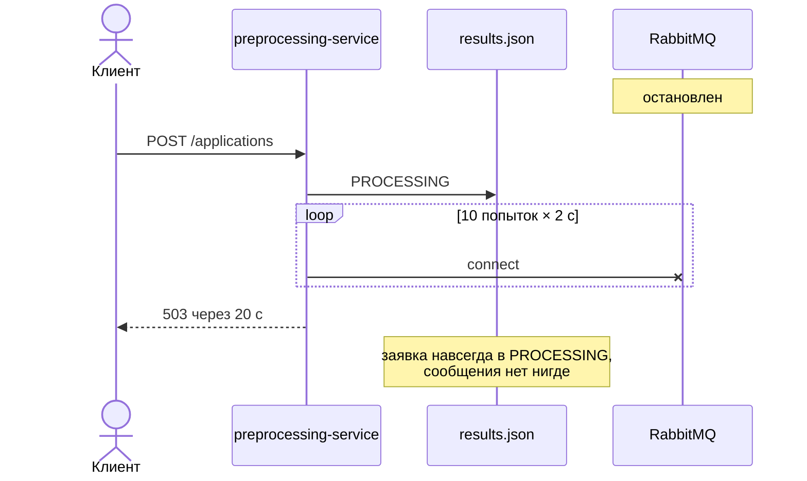

# 4. Интеграция

## Канал

| Параметр | Значение | Зачем |
|---|---|---|
| Брокер | RabbitMQ, обменник по умолчанию | — |
| Очередь | `processed_data_queue`, `durable` | переживает перезапуск брокера |
| Сообщение | `delivery_mode = 2` (persistent), `application/json` | не теряется при перезапуске |
| Потребитель | `prefetch_count = 1`, ручное подтверждение после записи результата | сообщение не пропадёт, если потребитель упадёт во время обработки |
| Ошибка обработки | `basic_nack(requeue=False)`, **очереди ошибок нет** | бесконечный повтор исключён, но сообщение теряется — G-6 |
| Схема | [JSON Schema](../schemas/processed_message_schema.json), `schema_version = "1.0"` | версионирование контракта |
| Гарантия доставки | at-least-once; дубликаты отсекает проверка финального статуса у потребителя | — |

Контракты: [OpenAPI](api/openapi.yaml) для REST, [AsyncAPI](api/asyncapi.yaml) для очереди.

## Основной сценарий с ручной проверкой



## Система решений недоступна — работает (сц. 8)



## Брокер недоступен — не работает (сц. 10)



### TO-BE: outbox

```mermaid
sequenceDiagram
    actor C as Клиент
    participant P as Сервис заявок
    participant DB as PostgreSQL
    participant R as Релей outbox
    participant Q as RabbitMQ
    C->>P: POST /applications
    P->>DB: BEGIN; заявка + запись в outbox; COMMIT
    P-->>C: 202 за миллисекунды
    loop каждую секунду
        R->>DB: неотправленные записи outbox
        R->>Q: publish
        R->>DB: отметить отправленные
    end
```

Заявка и сообщение сохраняются атомарно. Брокер может лежать сколько угодно: клиент получает ответ сразу, сообщения уйдут после восстановления.
